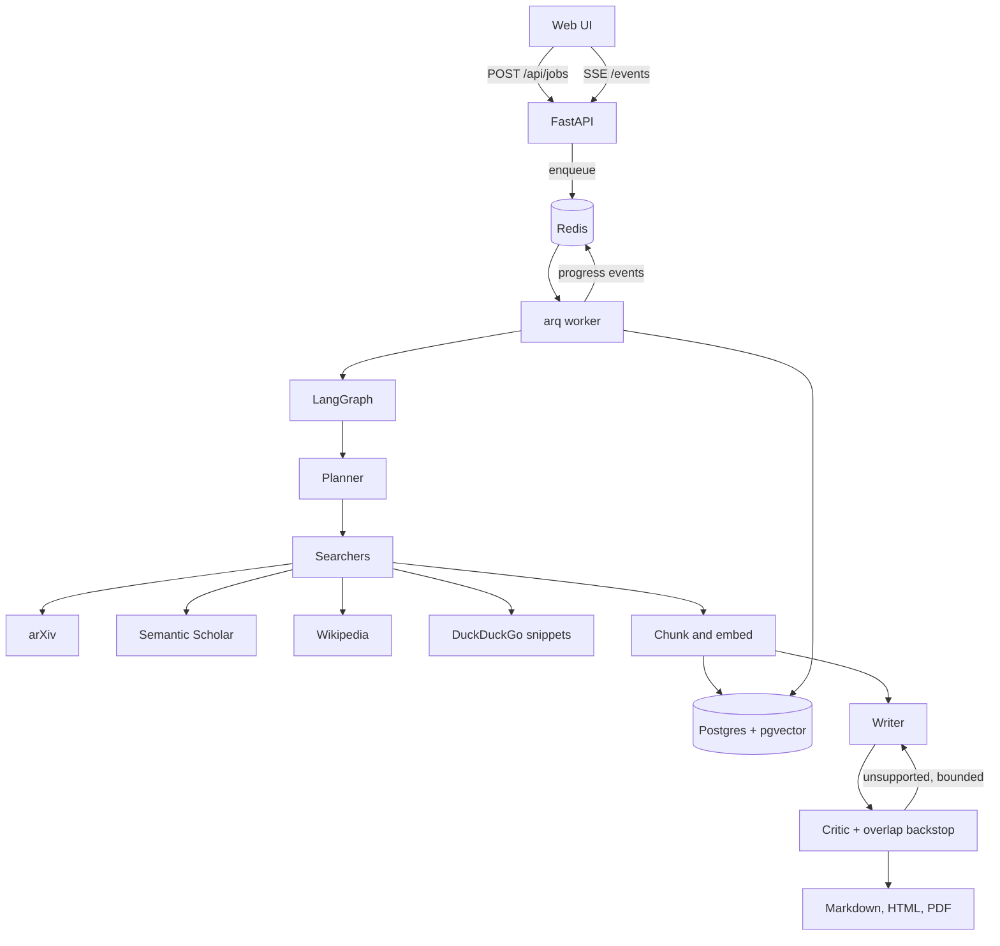

# Vellum

Vellum is a multi-agent research-to-report engine. You ask a question. A planner splits it, searchers read papers and the web in parallel, a writer drafts a structured report with inline citations, and a critic checks every claim against the cited source text. Unsupported claims go back to the writer, up to a fixed number of times. The finished report is Markdown, HTML, or PDF.

It is built to run at **zero cost**. Hosted models are the Groq and Gemini free tiers, with Ollama as a local option, behind one provider interface. With no API key the stack still boots: search hits free public APIs, and an extractive writer quotes those sources so the citation check can pass. Embeddings default to a local hashing embedder. [fastembed](https://github.com/qdrant/fastembed) is included for a real ONNX model when you want one. Nothing in the default path calls a paid service.



## Quick start

Docker Compose is the supported way to run the whole system: API, worker, Postgres with pgvector, and Redis.

```bash
docker compose up --build
```

Open [http://localhost:8000](http://localhost:8000) and run one of the sample questions. The default `LLM_PROVIDER=mock` needs no key. The first real search can take a little while because each source host is limited to one request per second.

```bash
curl -s -X POST http://localhost:8000/api/jobs \
  -H 'content-type: application/json' \
  -d '{"question":"What are the main ideas behind retrieval-augmented generation?"}'
```

Poll `GET /api/jobs/{id}` or watch `GET /api/jobs/{id}/events` (SSE). Download the report:

```bash
curl -s "http://localhost:8000/api/jobs/{id}/report?format=md"
curl -s "http://localhost:8000/api/jobs/{id}/report?format=html" -o report.html
curl -s "http://localhost:8000/api/jobs/{id}/report?format=pdf" -o report.pdf
```

`./scripts/smoke.sh` waits for health, submits that question, and prints the report.

To use a free hosted model, export a key and restart. Compose reads variables from the shell or a `.env` file in this directory (see `.env.example`).

```bash
export LLM_PROVIDER=groq
export GROQ_API_KEY=gsk_...
docker compose up --build
```

```bash
export LLM_PROVIDER=gemini
export GEMINI_API_KEY=...
docker compose up --build
```

Ollama stays on the host. Compose maps `host.docker.internal` so the containers can reach it:

```bash
ollama pull llama3.2
export LLM_PROVIDER=ollama
docker compose up --build
```

Swap the embedder when you want semantic retrieval instead of feature hashing. The first call downloads `BAAI/bge-small-en-v1.5` into a Docker volume. The column is fixed at 384 dimensions, which matches that model.

```bash
export EMBEDDING_PROVIDER=fastembed
docker compose up --build
```

Optional tracing: `docker compose --profile obs up` starts [Phoenix](https://github.com/Arize-ai/phoenix). Then set `OTEL_ENABLED=true` and `OTEL_EXPORTER_OTLP_ENDPOINT=http://phoenix:6006/v1/traces`. With tracing on and no endpoint, spans print to the process log.

## What the pipeline does

1. **Plan.** The planner returns 2–3 search questions. If the model reply is not valid JSON, the job continues with a heuristic split and records that on the timeline.
2. **Search.** arXiv, Semantic Scholar, Wikipedia, and DuckDuckGo run for every sub-question. Failures are isolated. Results are deduped, preferring papers, then cached in Redis for a day.
3. **Index.** Source text is chunked, embedded, and stored in pgvector. Retrieval picks which sources the writer sees and can append a matching chunk past the lead paragraph.
4. **Write.** The writer must attach source numbers to factual sentences and return a JSON draft. Claims are capped so the critic loop stays bounded.
5. **Critique.** The critic judges each claim against the cited text only. A lexical backstop overrides a "supported" verdict when the cited text barely overlaps the claim, which catches citations the model waved through. Unsupported claims return to the writer until `MAX_REVISION_LOOPS` (default 2).
6. **Report.** Markdown includes the plan, a verification list, and references. HTML is print-ready. PDF is a plain-text rendering of the same markdown.

If search returns nothing, the writer is not called. The report says no source text was retrieved, instead of filling the gap with generated claims.

The UI shows each agent event as it lands, then the report with a support count and download links.

## API

| Method | Path | Purpose |
| --- | --- | --- |
| `GET` | `/health`, `/ready` | Liveness, and Postgres + Redis readiness |
| `GET` | `/api/meta` | Active provider, model, embedder |
| `GET` | `/api/examples` | Sample questions |
| `POST` | `/api/jobs` | Queue a question. Optional `Idempotency-Key` header |
| `GET` | `/api/jobs` | Recent jobs |
| `GET` | `/api/jobs/{id}` | Status, stats, markdown when finished |
| `GET` | `/api/jobs/{id}/events` | Server-sent progress |
| `GET` | `/api/jobs/{id}/log` | The same events as JSON |
| `GET` | `/api/jobs/{id}/report?format=md\|html\|pdf` | Download |

Interactive docs: [http://localhost:8000/docs](http://localhost:8000/docs).

Questions must be 12–800 characters. Job creation is limited per IP (`JOB_RATE_LIMIT_PER_MINUTE`, default 6). General API calls use a wider window. Limits live in Redis. If Redis cannot be reached for a counter, the request is allowed and a warning is logged; the queue itself still has to be up for a job to run.

## Configuration

Every setting is an environment variable. `.env.example` lists them. Empty values are ignored, so you can leave keys blank.

| Variable | Default | Role |
| --- | --- | --- |
| `LLM_PROVIDER` | `mock` | `groq`, `gemini`, `ollama`, or `mock` |
| `LLM_MODEL` | provider default | Groq `llama-3.1-8b-instant`, Gemini `gemini-2.0-flash`, Ollama `llama3.2` |
| `EMBEDDING_PROVIDER` | `hash` | `hash` or `fastembed` |
| `MAX_REVISION_LOOPS` | `2` | Extra writer passes after the first draft |
| `SEARCH_RATE_LIMIT_RPS` | `1` | Shared per-host cap across workers |
| `WORKER_MAX_JOBS` | `2` | Concurrent research jobs per worker process |
| `SEMANTIC_SCHOLAR_API_KEY` | empty | Optional. Raises the unauthenticated cap |
| `OTEL_ENABLED` | `false` | Export spans when true |

Provider defaults target models that have been on free tiers. If a vendor retires a model name, set `LLM_MODEL`.

### Free keys

- **Groq:** [console.groq.com](https://console.groq.com) → API key. Free tier, no card required for the default models.
- **Gemini:** [Google AI Studio](https://aistudio.google.com/apikey) → API key. Use a Flash model on the free tier. The key is sent as `x-goog-api-key`, not in the URL.
- **Semantic Scholar:** [API key request](https://www.semanticscholar.org/product/api#api-key-form). The pipeline works without one; unauthenticated calls are slower and more likely to 429.
- **Ollama:** [ollama.com](https://ollama.com). No key. Pull a small model first.

## Develop

Python 3.11 or newer.

```bash
make install          # pip install -e ".[dev]"
make ci               # ruff, mypy, pytest
make eval             # citation-faithfulness fixtures
```

`make install-embeddings` adds fastembed. CI does not install it; tests never download a model.

The faithfulness harness scores checked-in claims with the same overlap function the critic uses as a backstop. `python -m research_engine.eval.harness` exits non-zero if a fixture is mislabeled. Fixtures live in `src/research_engine/eval/fixtures.json`.

Tests cover the LangGraph loop with a scripted model (including the revision path), the extractive mock end to end, provider-down fallback, search parsing and caching with a fake HTTP transport, Groq retry on 429, the job API, idempotency, and rate limits. They do not need Postgres or a network.

## Design decisions

**LangGraph for the loop, not a hand-rolled while.** The topology is visible: plan → search → index → write → critique, and critique either returns to write or finalizes. The revision counter lives in graph state, so the bound cannot be skipped by a confused model.

**arq rather than Celery.** The API and the worker are both asyncio. arq is a Redis queue with a small surface: one function, `run_research`, `max_tries=1`. Model calls already retry internally; a second full research job would burn free-tier quota twice.

**The request path only enqueues.** `POST /api/jobs` writes a row, publishes `job.queued`, and returns 202. The worker runs the graph. Progress is a row in `job_events` plus a Redis publish. SSE replays the rows, then follows the channel, and drops duplicates by sequence number so a subscribe/replay race cannot skip or repeat an event.

**One provider interface.** `LLMProvider.complete()` is what the graph calls. Groq, Gemini, and Ollama are thin REST clients with timeouts, jittered retries on 429/5xx, and a single retry without JSON mode if a model rejects `response_format`. Secrets are stripped from error text. The mock implements the same interface: scripted replies in tests, extractive quoting in the demo.

**Search does not crawl the open web.** Adapters keep the abstract, extract, or snippet the API already returned. Result URLs are stored as citations and never fetched. That removes a class of SSRF bugs and keeps us inside public rate limits. A Redis lock (`SET NX PX`) is the shared rate limiter, so adding workers does not multiply traffic to arXiv.

**Hybrid critic.** The model is the primary judge, because a paraphrase can be faithful with modest word overlap. The backstop only flips a "supported" verdict when overlap is very low or the claim has no citation. Exact excerpts, which is what the mock writer produces, score as supported. The verification section of the report shows the verdict and the overlap so a reader can see what was checked.

**Embeddings you can run offline.** Hashing tokens and bigrams into 384 dimensions is weak semantically and strong operationally: no download, deterministic, good enough to rank a tiny per-job corpus and to test retrieval without a model file. fastembed is the production-quality local option and is loaded only when selected. pgvector uses cosine distance and an HNSW index.

**Schema on boot, not Alembic.** `schema.sql` is applied idempotently under a Postgres advisory lock so the API and the worker can start together. The schema is one file and one version. A migration tool is the right next step when the tables start to change.

**Tracing is optional.** Spans wrap the job and each agent. The default provider is a no-op, so importing the app does not export anywhere. Phoenix is a Compose profile, not a required container.

## Scaling and cost control

- **Workers scale out.** Run more `worker` containers against the same Redis and Postgres. `WORKER_MAX_JOBS` caps concurrency inside one process. The search limiter and the source cache are shared, so extra workers do not stampede arXiv or Semantic Scholar.
- **The queue is the isolation boundary.** A slow model call never holds a uvicorn worker. Job timeout defaults to 10 minutes. On startup, the worker marks `running` jobs older than that as failed so a crash does not leave them spinning.
- **Cache and caps.** Search responses live in Redis for `CACHE_TTL_SECONDS` (one day). The writer sees at most `MAX_SOURCES_FOR_WRITER` sources, each clipped before it enters the prompt. Claims and sections are truncated. Revision passes are capped. `llm_max_tokens` bounds generation.
- **Free-tier hygiene.** Default hosted models are the small free ones. JSON repair is a single extra call, not a loop. `max_tries=1` at the job level. The mock provider is the default so a fresh clone does not spend quota by accident.
- **Cost of embeddings is CPU, not an API.** Hashing is free. fastembed runs in a thread so it does not block the event loop. The model cache is a volume.

## Limitations

- Sources are abstracts, encyclopedia leads, and search snippets, not full-text PDFs. The report cannot know what a paper says beyond that text.
- The overlap backstop is not an entailment model. A fluent paraphrase with almost no shared words can be marked unsupported; a claim that shares a few content words can pass the backstop if the model critic also accepts it.
- The mock writer quotes. It does not synthesize. The timeline and the UI say so.
- PDF export uses a built-in Latin-1 font. Markdown and HTML keep the full Unicode report.
- Embedding width is fixed at 384. Another dimension means a schema change.
- There is no authentication. Rate limits assume a local or trusted network. Do not expose the API to the public internet as-is.
- Semantic Scholar's unauthenticated tier is easy to exhaust. Failures there are logged and skipped; the rest of the search continues. DuckDuckGo sometimes answers the HTML endpoint with a bot check instead of snippets. The job still finishes from the other sources.
- `docker compose up` pulls images and, if you enable fastembed, a model. The Python tests themselves stay offline.

## Layout

```
src/research_engine/
  agents/        LangGraph, prompts, rendering, extractive fallback
  api/           FastAPI routes, validation, rate limits
  db/            schema and repository
  eval/          citation-faithfulness fixtures and harness
  jobs/          arq worker, enqueue, SSE fan-out
  llm/           Groq, Gemini, Ollama, mock
  rag/           chunker, hash/fastembed, pgvector
  search/        arXiv, Semantic Scholar, Wikipedia, DuckDuckGo
frontend/        single-page UI
```

## License

MIT.
